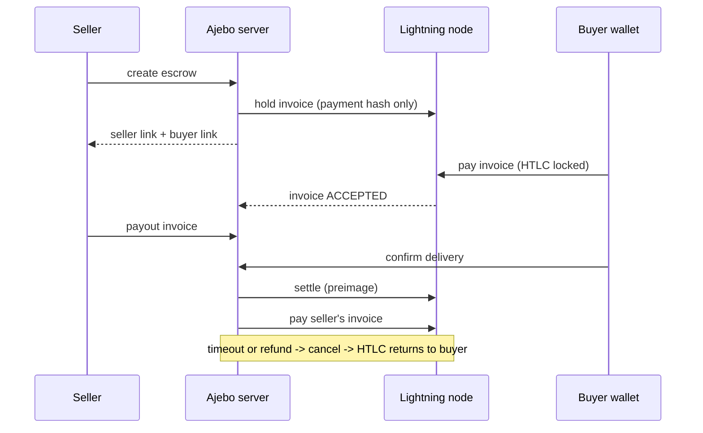

# Ajebo Escrow

**Lightning escrow for social-media sellers.** A buyer pays into a hold invoice, and the sats stay locked until the buyer confirms delivery. Built for the Dakar Bitcoin Hack by Btrust.

**Live demo: https://ajebo-escrow.fly.dev** (demo mode: payments are simulated, no real money). Create an escrow, open the buyer link, tap *Dev: simulate payment*, then on the seller page tap *Demo: use a test invoice*, and confirm as the buyer. Real Lightning is shown in the demo video and in [`scripts/e2e-lightning.mjs`](scripts/e2e-lightning.mjs). To deploy your own, see [DEPLOY.md](DEPLOY.md).

## The problem
Millions of Nigerian and African merchants sell on Instagram and WhatsApp. Buyers fear paying first and being scammed. Sellers lose sales because buyers won't pay first. Cards and bank transfers offer no neutral middle.

## How it works
1. **Seller** creates an escrow (item, price in sats, hold time) and shares the buyer link.
2. **Buyer** opens the link and pays a Lightning invoice. The payment is **held**, not settled. The seller cannot touch it.
3. **Seller** adds a payout invoice and ships.
4. **Buyer** taps *I received the goods*. The server settles the hold invoice and pays the seller.
5. If the buyer never confirms, or the seller refunds, the HTLC is cancelled and the sats return to the buyer.



## Quick start (no Lightning node needed)
```bash
npm start                 # http://localhost:3000, mock Lightning backend
npm test                  # state machine, auth and race tests
docker compose up --build # same thing in Docker
```
In demo mode a banner says payments are simulated. The buyer page has a **Dev: simulate payment** button, and the seller page has **Demo: use a test invoice**, so you can run the full flow with no wallet.

## Real Lightning (regtest/signet only while developing)
Tested against **LND 0.20.0** on a [Polar](https://lightningpolar.com/) regtest network.

1. In Polar, create a network with two LND nodes: `alice` (the app's node) and `bob` (the buyer's and seller's wallet). Fund both and open a channel each way, so alice can receive the buyer's payment and pay the seller.
2. Bake a **least-privilege macaroon** on alice: invoices read/write and off-chain read/write only. It cannot touch on-chain funds; we checked that on-chain balance, new address and send-coins calls are all denied.
   ```bash
   lncli bakemacaroon invoices:read invoices:write offchain:read offchain:write info:read
   ```
3. Copy `.env.example` to `.env` and set `LN_BACKEND=lnd`, `LND_REST_URL` (alice's REST port), `LND_MACAROON_HEX` and `LND_TLS_CERT_PATH` (alice's `tls.cert`).
4. Start the app against LND:
   ```bash
   npm run start:lnd
   ```

### End-to-end test on real Lightning
[`scripts/e2e-lightning.mjs`](scripts/e2e-lightning.mjs) drives the app while bob pays real hold invoices. It checks:
- **Happy path:** the buyer's sats are locked in flight, confirming delivery settles the invoice, and the seller is paid over Lightning.
- **Refund path:** the seller refunds and the buyer gets every sat back.

```bash
APP_URL=http://localhost:3000 BOB_REST_URL=https://localhost:8082 BOB_MACAROON_HEX=<bob admin macaroon hex> NODE_EXTRA_CA_CERTS=<bob tls.cert> node scripts/e2e-lightning.mjs
```

## Layout
- `src/escrow.js`: state machine, auth, locking
- `src/lightning/`: `mock.js` and `lnd.js` behind one small interface
- `src/server.js`: HTTP API and static files (zero dependencies)
- `public/`: server-rendered-style pages, about 4 KB of JS, no framework, works on mid-range phones
- `test/`: node:test suite (mock backend)
- `scripts/e2e-lightning.mjs`: end-to-end test on a real regtest Lightning network

## Security
See [SECURITY.md](SECURITY.md) for the threat model and known limits.

## Status and next steps
- [x] Escrow state machine with tests
- [x] Mock Lightning backend and full UI flow
- [x] LND adapter verified on regtest (hold invoice, settle, cancel, payout)
- [x] Least-privilege macaroon (no on-chain access)
- [x] Deployed on Fly.io with a persistent volume (verified: held escrows survive a restart)
- [ ] Record the 3-minute demo
- [x] Decode payout invoices: exact amount, expiry, network; confirm is blocked if the seller's invoice expired
- [x] Deploy config: Fly.io with a persistent volume, health check, test-network banner, mainnet guard
- [ ] Nostr notifications to buyer and seller
- [ ] Naira price display
- [ ] Arbiter for disputes
