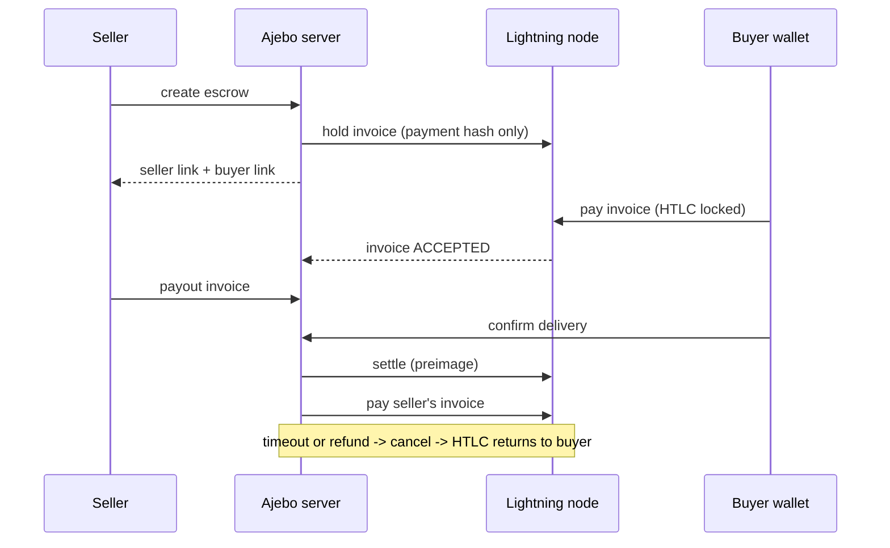

# Ajebo Escrow

**Lightning escrow for social-media sellers.** A buyer pays into a hold invoice, and the sats stay locked until the buyer confirms delivery. Built for the Dakar Bitcoin Hack by Btrust.

## The problem
Millions of Nigerian and African merchants sell on Instagram and WhatsApp. Buyers fear paying first and being scammed. Sellers lose sales because buyers won't pay first. Cards and bank transfers offer no neutral middle.

## How it works
1. **Seller** creates an escrow (item, price in sats, hold time) and shares the buyer link.
2. **Buyer** opens the link and pays a Lightning invoice. The payment is **held**, not settled. The seller cannot touch it.
3. **Seller** adds a payout invoice and ships.
4. **Buyer** taps *I received the goods*. The server settles the hold invoice and pays the seller.
5. If the buyer never confirms, or the seller refunds, the HTLC is cancelled and the sats return to the buyer.



## Quick start (no Lightning node needed)
```bash
npm start                 # http://localhost:3000, mock Lightning backend
npm test                  # state machine, auth and race tests
docker compose up --build # same thing in Docker
```
The mock backend shows a **Dev: simulate payment** button on the buyer page so you can run the full flow with no wallet.

## Real Lightning (regtest/signet only while developing)
1. Create an LND node in [Polar](https://lightningpolar.com/).
2. Copy `.env.example` to `.env`, set `LN_BACKEND=lnd`, `LND_REST_URL`, `LND_MACAROON_HEX` (restricted macaroon: invoices and off-chain only).
3. Set `NODE_EXTRA_CA_CERTS` to the node's `tls.cert`, then `npm start`.

The LND adapter in `src/lightning/lnd.js` is a scaffold. It has not yet been run against a live node.

## Layout
- `src/escrow.js`: state machine, auth, locking
- `src/lightning/`: `mock.js` and `lnd.js` behind one small interface
- `src/server.js`: HTTP API and static files (zero dependencies)
- `public/`: server-rendered-style pages, about 4 KB of JS, no framework, works on mid-range phones
- `test/`: node:test suite

## Security
See [SECURITY.md](SECURITY.md) for the threat model and known limits.

## Status and next steps
- [x] Escrow state machine with tests
- [x] Mock Lightning backend and full UI flow
- [ ] Verify the LND adapter on regtest
- [ ] Decode payout invoices (amount and expiry check)
- [ ] Nostr notifications to buyer and seller
- [ ] Naira price display
- [ ] Arbiter for disputes
